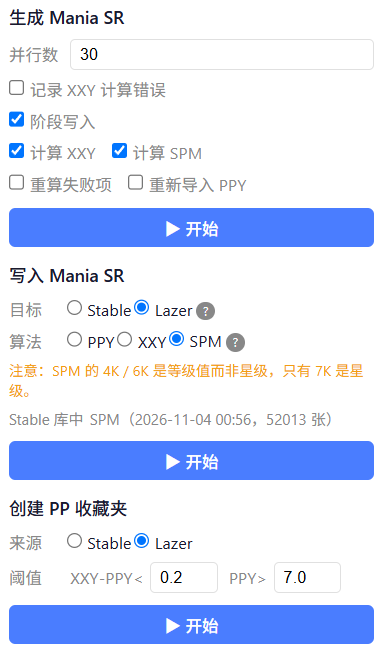

# OsuLocalServer

osu本地数据服务

## Mania Lab 前端

[仓库地址](https://github.com/zzzzv/mania-lab)

打开首页自动下载最新版，设置页可切换已下载版本。

## 页面

| 页面 | 路径 | 说明 |
| --- | --- | --- |
| 状态 | `/` | 各模块可用性 |
| 设置 | `/settings` | 图形化配置管理 |
| 管理 | `/management` | 后台任务与日志 |

## 管理

页面 `/management`，左侧配置任务、右侧实时日志（SignalR 推送），同一时间只运行一个任务。



- **生成 Mania SR** — 枚举 stable（`osu!.db`）与 Lazer（`client.realm`）中的 Mania 谱面，计算 PPY / XXY / SPM，存入 `mania_sr.msgpack`。PPY 只在首次导入时读库，之后以 msgpack 为准；支持断点续跑。
- **写入 Mania SR** — 写回 `osu!.db`（NM / HT / DT 三槽）或 `client.realm`（仅 NM）。只写该算法有值的谱面，不退回其它算法，因此库里不会混用多种算法。
- **创建 PP 收藏夹** — 筛选 `XXY - PPY < 阈值` 且 `PPY > 下限`，创建 `PP` / `PP HT` / `PP DT` 收藏夹。

> **SPM 的 4K / 6K 输出是模型自身的等级值，不是星级**，只有 7K 是星级量纲，写入后游戏内显示的不再是星数。

`mania_sr.msgpack`（默认 `%LOCALAPPDATA%\OsuLocalServer`）为紧凑二进制格式：每条记录 `[状态位, PPY, XXY, SPM]`，SR 为 `[NM, HT, DT]`，不写字段名；旧格式首次加载时自动迁移并备份为 `.bakN`。

## API

### GET

| 路径 | 说明 |
| ------ | ------ |
| `/api/status` | 各模块可用性 |
| `/api/stable/files/{**relativePath}` | 从 osu!stable 目录读取文件，支持 `*` 通配符 |
| `/api/stable/folder/{**folderPath}` | 列出 stable 目录下指定文件夹内的所有文件名、大小和修改时间 |
| `/api/lazer/scores?rql=...&depth=N` | RQL 查询 Score |
| `/api/lazer/beatmaps?rql=...&depth=N` | RQL 查询 Beatmap |
| `/api/lazer/beatmapsets?rql=...&depth=N` | RQL 查询 BeatmapSet |
| `/api/lazer/collections?rql=...&depth=N` | RQL 查询 Collection |
| `/api/lazer/files/{hash}` | 按 hash 获取文件 |
| `/api/osuapi/v2/**` | 反向代理到 osu.ppy.sh |
| `/api/management/mania-sr/msgpack` | 返回 `mania_sr.msgpack` 文件 |

> **查询参数说明**：  
> `depth` — 递归展开层数，默认 `0`（仅顶层），`1` 展开直接属性，`2` 展开嵌套属性，以此类推。  
> `noExpand` — 跳过指定字段的递归展开，可重复使用（`&noExpand=FieldA&noExpand=FieldB`），用于控制返回数据大小，避免对象图循环膨胀。

### POST

#### `/api/stable/collection/update`

更新 stable 收藏夹。`overwrite` 为 `true` 时覆盖（替换整个收藏夹），为 `false`（默认）时追加去重。

```json
{ "name": "...", "beatmapMd5Hashes": ["...", "..."], "overwrite": false }
```

#### `/api/stable/star-rating/update`

批量写入 Mania Star Rating（NM/HT/DT）到 stable 的 `osu!.db`。

```json
{ "starRatings": { "<md5>": { "nm": 6.53, "ht": 5.21, "dt": 7.82 } } }
```

#### `/api/lazer/collection/update`

更新 lazer 收藏夹。`overwrite` 为 `true` 时覆盖（替换整个收藏夹），为 `false`（默认）时追加去重。

```json
{ "name": "...", "beatmapMd5Hashes": ["...", "..."], "overwrite": false }
```

#### `/api/lazer/star-rating/calculate?mods=...`

计算谱面 Star Rating，body 为原始 .osu 文件内容，mods 通过查询参数传递（JSON 数组，需 URL 编码）。

```http
POST /api/lazer/star-rating/calculate?mods=[{"acronym":"DT","settings":{"speed_change":1.5}},{"acronym":"HR"}]
Content-Type: text/plain

osu file format v14...
```

#### `/api/lazer/star-rating/update`

批量写入 Star Rating 到 lazer 的 `client.realm`。

```json
{ "starRatings": { "<md5>": 6.53, "<md5>": 4.21 } }
```

#### `/api/tools/xxy-calculate?speedRate=...`

使用 StarRatingRebirth 计算 XXY SR。body 为原始 .osu 文件内容，`speedRate` 通过查询参数传递。

```http
POST /api/tools/xxy-calculate?speedRate=1.5
Content-Type: text/plain

osu file format v14...
```
